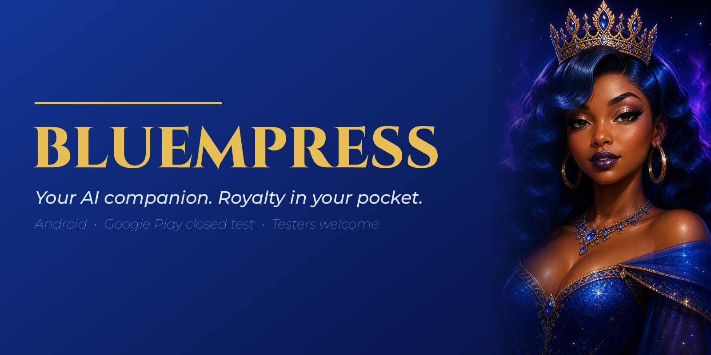
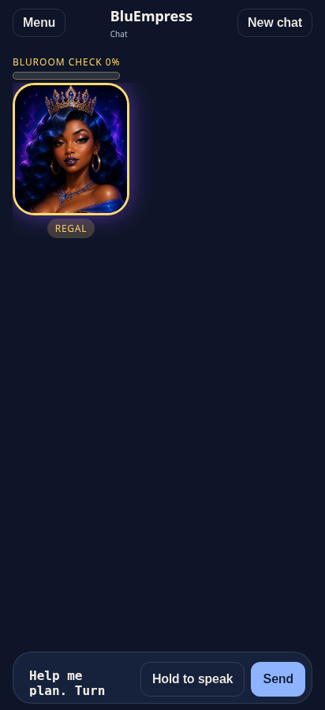
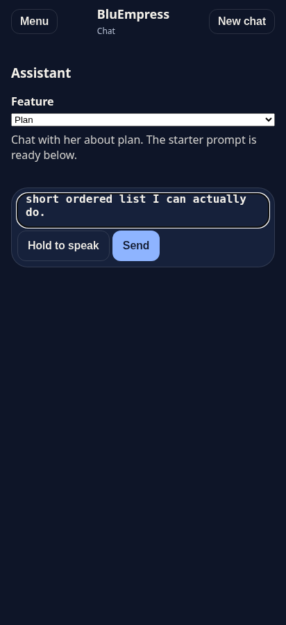
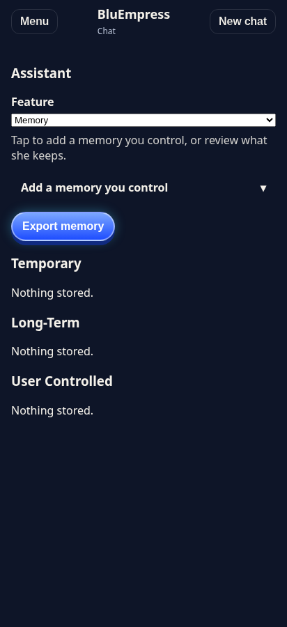
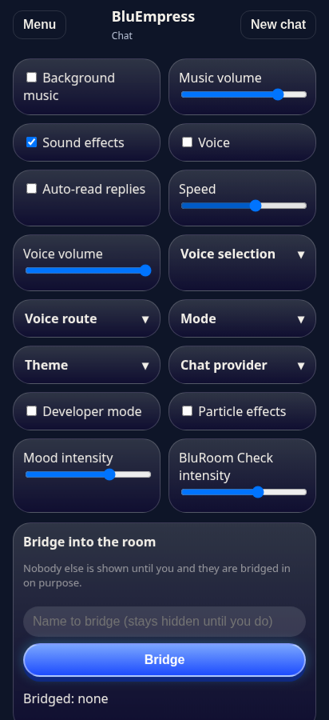
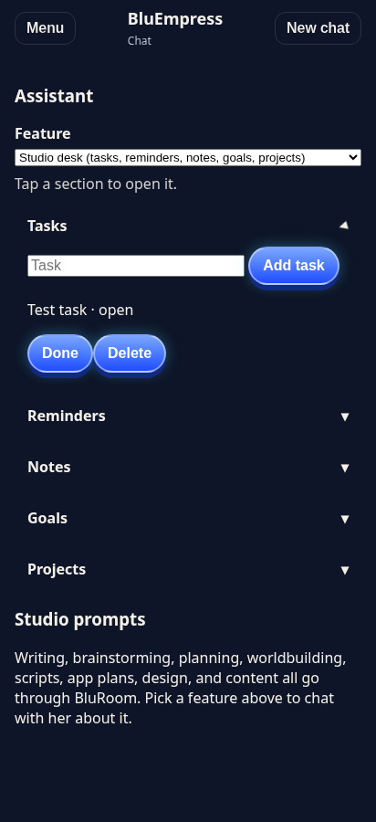

# 👑 BluEmpress

**Chat with a royal AI queen. Android app, now in a Google Play closed test.**

*Testers wanted · Free · Voluntary · 18+*

---

## ✨ What is BluEmpress?

BluEmpress is an Android app where you talk to **BluEmpress**, a fictional AI queen character with a New Orleans-inspired voice and royal-blue-and-gold style. She is entertainment, not a person. You open the **BluRoom**, chat, and watch her mood and portrait change with the conversation.

- **Package:** `com.bluempressuniverse.app`
- **Status:** Google Play **closed test** (beta), version 8.0.0
- **Age:** 18 and older

## 🌟 Features (what the beta really has today)

| | |
|---|---|
| 💬 **Chat** | Talk to BluEmpress in the BluRoom. Replies come from Google's Gemini models. |
| 🎭 **9 moods with portraits** | Regal, Playful, Confident, Arrogant, Sassy, Calm, Mischievous, Focused, and BluRoom. |
| 🎚️ **5 chat modes** | Regal, Focused, Playful, Guarded, and BluRoom change her tone and length. |
| 💙 **BluRoom Check** | A rare, random moment where her eyes and crown glow and she resets the energy with extra sass (never cussing). |
| ⚡ **Quick actions** | One-tap starters: brainstorm, write, plan, worldbuild, goals, script, app plan, design, content. |
| 🧠 **Memory you control** | Temporary, long-term, and user-controlled memories you can add, review, and export. |
| 🗂️ **Studio desk** | Tasks, reminders, notes, goals, and projects you can chat with her about. |
| 🎙️ **Voice** | Hold to speak and auto-read replies using your phone's text-to-speech. |
| 🎛️ **Settings** | Music, sound effects, volume, speed, particles, theme, and mood and BluRoom Check intensity. |
| 🌉 **Bridge** | Bring a name into the room on purpose, and remove it when you're done. |
| 🚩 **Report** | Tap Report on any reply to flag it. |

The machine-readable version lives in [`data/features-roadmap.json`](data/features-roadmap.json). Ideas are marked `idea` and are **not promises**.

## 📸 Screenshots

  
  
  
  
  

*Screenshots are from the app and may differ slightly from your build.*

## 🧪 Join the closed test

Google Play requires closed-test apps to be tested by real people. Here is how to help, in 3 steps:

1. **Sign up.** Enter your email at the [signup form](https://docs.google.com/forms/d/e/1FAIpQLSe9xwqTplppsbXFboRZ43DdTWTdFVZUpScbXGt7jL6VBu_v5g/viewform). You are **automatically added and approved**.
2. **Opt in.** Open the [opt-in page](https://play.google.com/apps/testing/com.bluempressuniverse.app) with the **same Google account** and become a tester.
3. **Install from Google Play** and **keep it installed and opted in for 14 days.** Open it now and then.

You need an Android device, a Google account, and to be 18 or older. Stuck? Open a [Tester signup help issue](https://github.com/binkybell225/BluEmpress/issues/new/choose) (never post your email).

> **Honest note:** testing is **voluntary**. **No payment, reward, or compensation is promised.** You are helping a small project get tested, and we're grateful.

## 🗣️ What feedback we want

- Crashes, freezes, or anything that looks broken
- Replies that feel wrong, off-tone, or unsafe
- Do the moods, portraits, and BluRoom Check feel right?
- Does voice (speaking and read-aloud) work on your phone?
- Is Memory or the Studio desk confusing or useful?
- Anything you wish it did

## 🐞 How to report a bug

1. Open a [Bug report](https://github.com/binkybell225/BluEmpress/issues/new/choose).
2. Tell us what happened, your **phone model**, **Android version**, and **app version**.
3. Add a screenshot if you can (crop out anything private).
4. **Never post your email, passwords, or private details.** Everything here is public.

Security problem? Report it privately: see [SECURITY.md](SECURITY.md).

## ❓ FAQ

<b>Is it free?</b>
Yes. No payment is needed, and no payment or rewards are promised for testing.

<b>Why 14 days?</b>
Google Play asks closed-test apps to be tested by real people for 14 days in a row. Keeping it installed and opted in helps.

<b>What happens to my email?</b>
It's used only to add you to the closed test and send the install link. It is not sold. You can ask for deletion any time. See <a href="PRIVACY.md">PRIVACY.md</a>.

<b>Is BluEmpress a real person?</b>
No. She is a fictional AI character, and not a therapist, doctor, lawyer, or emergency contact.

<b>Is there an iPhone version?</b>
Not an App Store app. iPhone users can use the web version with Add to Home Screen; ask in <a href="https://github.com/binkybell225/BluEmpress/discussions">Discussions</a>.

<b>Is the app open source?</b>
No. The app and brand are all rights reserved. Only the JSON in <a href="data">/data</a> is open for suggestions under CC BY-NC-SA 4.0.

<b>Can I help improve it?</b>
Yes! Suggest changes to the JSON data through issues or pull requests. The owner reviews everything and can't promise to merge every idea. See <a href="CONTRIBUTING.md">CONTRIBUTING.md</a>.

More answers: [`data/faq.json`](data/faq.json).

## 📂 Public data (open for suggestions)

The [`/data`](data) folder has real JSON the community can help improve: the [features roadmap](data/features-roadmap.json), [moods](data/moods.json), [BluRoom Check lines](data/bluroom-check.json), [FAQ](data/faq.json), and [tester guide](data/tester-guide.json), with [JSON Schemas](data/schema). A read-only GitHub Action validates every pull request.

## 📜 License in plain words

| What | Rule |
|---|---|
| **The app, the name and logos, the character and portraits, screenshots, and this README** | **All rights reserved.** Personal, non-commercial play and testing is fine. No redistributing the app, no republishing it under another name, no commercial use. |
| **The JSON in [/data](data)** | **CC BY-NC-SA 4.0.** Share and adapt with credit, non-commercial only, share alike. This does not license the app, character, or brand. |

Read the full [LICENSE](LICENSE). The app's source code is **not** published here.

## 🛡️ Safe by design

Nobody except the owner can change the app or this repository. `main` is protected, every change needs owner review, and outside contributors work through forks and pull requests to `/data` only.

## 📋 Legal and community

[Terms](TERMS.md) · [Privacy](PRIVACY.md) · [Disclaimer](DISCLAIMER.md) · [License](LICENSE) · [Contributing](CONTRIBUTING.md) · [Code of Conduct](CODE_OF_CONDUCT.md) · [Security](SECURITY.md) · [Support](SUPPORT.md)

App [Privacy Policy](https://bluempress-lzezh6wzea-uc.a.run.app/play/privacy.html) · App [Terms](https://bluempress-lzezh6wzea-uc.a.run.app/play/terms.html)

BluEmpress is an independent project and is not affiliated with Google, Apple, GitHub, YouTube, TikTok, or Instagram. Trademarks belong to their owners.

---

👑 **Created by RnBKat with BluEmpressUni** 👑

